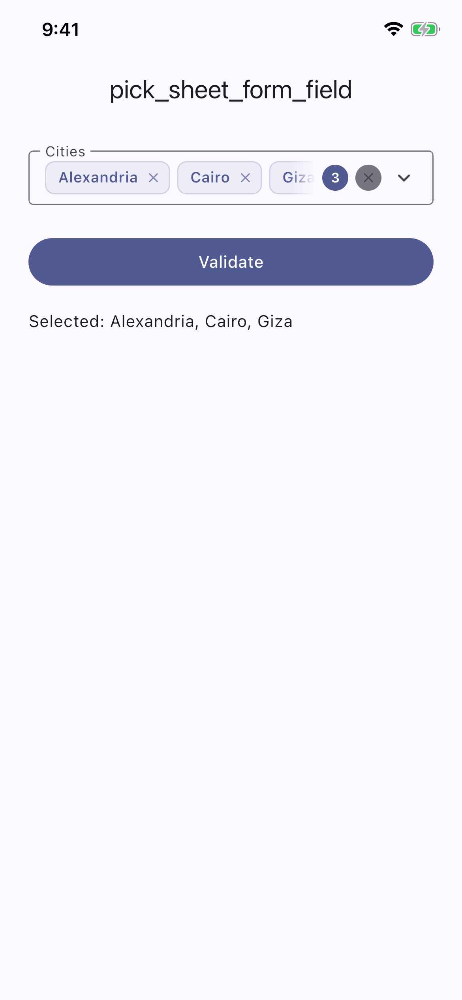
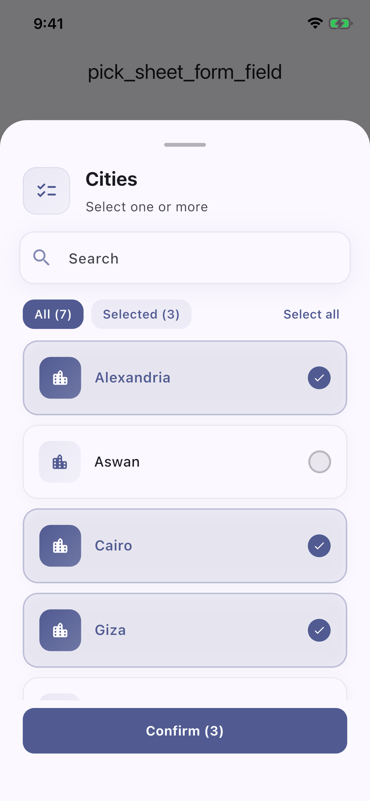

# pick_sheet_form_field

[](https://pub.dev/packages/pick_sheet_form_field)
[](LICENSE)

A multi-select `FormField` for Flutter. The selected values show as removable
chips inside an outlined field; tapping the field opens a bottom sheet with
search, "All / Selected" tabs and "Select all / Clear all".

<p>
  
  
</p>

## Features

- **A real form field**: `validator`, `onSaved`, `autovalidateMode`,
  `Form.validate()`, `save()` and `reset()` work like `DropdownButtonFormField`.
- **Chips in the field**: each selected value is a chip with a remove button,
  plus a "Clear all" button and a count badge.
- **Searchable sheet**: optional search box that matches labels and subtitles.
- **Selection limit**: `maxSelections` caps the picks; `maxSelections: 1` makes
  a single-select.
- **Async-friendly**: a loading placeholder, offline and failure states, and
  initial values that wait for their items to arrive.
- **Controller**: read, set, clear or reset the selection from code.
- **Themeable**: a `ThemeExtension` that falls back to your app's theme.
- **Translatable**: every text can be replaced; English by default; RTL ready.
- **No dependencies** beyond Flutter.

## Installation

```bash
flutter pub add pick_sheet_form_field
```

```dart
import 'package:pick_sheet_form_field/pick_sheet_form_field.dart';
```

Requires Dart 3.8 and Flutter 3.32 or newer.

## Quick start

```dart
class City {
  const City(this.id, this.name);
  final int id;
  final String name;

  // Items are compared with ==, so override it (or extend Equatable).
  @override
  bool operator ==(Object other) => other is City && other.id == id;
  @override
  int get hashCode => id.hashCode;
}

class CitiesForm extends StatefulWidget {
  const CitiesForm({super.key});

  @override
  State<CitiesForm> createState() => _CitiesFormState();
}

class _CitiesFormState extends State<CitiesForm> {
  static const _cities = [City(1, 'Cairo'), City(2, 'Giza'), City(3, 'Luxor')];

  final _formKey = GlobalKey<FormState>();
  List<City> _selected = const [];

  @override
  Widget build(BuildContext context) {
    return Form(
      key: _formKey,
      child: Column(
        children: [
          PickSheetFormField<City>(
            items: PickSheetItem.listOf(
              _cities,
              label: (city) => city.name,
              icon: Icons.location_city,
            ),
            labelText: 'Cities',
            searchEnabled: true,
            onChanged: (cities) => setState(() => _selected = cities),
            onSaved: (cities) => debugPrint('Saved: $cities'),
            validator: (cities) =>
                cities!.isEmpty ? 'Pick at least one city' : null,
          ),
          FilledButton(
            onPressed: () {
              if (_formKey.currentState!.validate()) {
                _formKey.currentState!.save();
              }
            },
            child: const Text('Submit'),
          ),
        ],
      ),
    );
  }
}
```

A runnable app is in [`example/lib/main.dart`](example/lib/main.dart).

## API reference

### `PickSheetFormField<T>`

The field. `T` is the type of the values; the field's value is a `List<T>`,
always in the order of `items`.

| Parameter | Type | Default | Description |
|---|---|---|---|
| `items` | `List<PickSheetItem<T>>` | **required** | The options. Rebuilding this list on every build is fine. |
| `labelText` | `String` | **required** | The field's label. Also the sheet title unless `sheetTitle` is set. |
| `initialValue` | `List<T>?` | `[]` | Values selected at start. Can change later (for example once data loads) without calling `onChanged`. Don't combine with `controller`. |
| `controller` | `PickSheetController<T>?` | `null` | Reads and changes the selection from code. Don't combine with `initialValue`. |
| `onChanged` | `ValueChanged<List<T>>?` | `null` | Called when the **user** changes the selection (confirming the sheet, removing a chip, "Clear all"). Not called for changes made from code. |
| `onSaved` | `FormFieldSetter<List<T>>?` | `null` | Called by `FormState.save()`. |
| `validator` | `FormFieldValidator<List<T>>?` | `null` | Returns an error text, or `null` when valid. The error shows under the field. |
| `autovalidateMode` | `AutovalidateMode` | `onUserInteraction` | When the validator runs automatically. |
| `enabled` | `bool` | `true` | A disabled field can't be opened and its chips can't be removed. |
| `status` | `PickSheetStatus` | `ready` | Loading state of `items`. See [Loading items](#loading-items). |
| `searchEnabled` | `bool` | `false` | Shows a search box at the top of the sheet. |
| `maxSelections` | `int?` | `null` | Most values the user can pick. Once reached, other items are disabled. `1` makes a single-select: picking replaces the previous value. |
| `sheetTitle` | `String?` | `labelText` | The sheet's title. |
| `sheetDescription` | `String?` | `strings.sheetDescription` | Text under the sheet's title. |
| `sheetIcon` | `IconData` | `Icons.checklist_rounded` | Icon in the sheet's header. |
| `decoration` | `InputDecoration?` | `null` | Overrides parts of this field's look (borders, padding, hint…). Values left `null` come from the theme. |
| `strings` | `PickSheetStrings?` | `null` | Texts for this field only. See [Translations](#translations). |

### `PickSheetItem<T>`

One option.

| Property | Type | Description |
|---|---|---|
| `value` | `T` | **Required.** What the field returns when this item is selected. Compared with `==`. |
| `label` | `String` | **Required.** The item's text in the sheet and on its chip. |
| `subtitle` | `String?` | Second line under the label. Search matches it too. |
| `icon` | `IconData?` | Icon before the label in the sheet. No icon box when `null`. |

Build a list from your models in one line:

```dart
PickSheetItem.listOf(
  cities,
  label: (city) => city.name,
  subtitle: (city) => city.country, // optional
  icon: Icons.place,                // optional, same icon for every item
)
```

### `PickSheetStatus`

| Value | What the field shows |
|---|---|
| `loading` | A placeholder the size of the field (replace it with `PickSheetConfig.loadingBuilder`). The field can't be opened. |
| `ready` | The field, ready to open. |
| `offline` | The field with an offline icon. Can't be opened. |
| `failure` | The field with an error icon. Can't be opened. |

### `showPickSheet<T>()`

Opens the sheet without a field, for example from an "Add filters" button.
Returns the selected values in `items` order, or `null` if the user dismissed
the sheet.

```dart
final cities = await showPickSheet<City>(
  context: context,
  items: items,
  title: 'Cities',
  initialSelected: current,
);
if (cities != null) setState(() => current = cities);
```

| Parameter | Type | Default | Description |
|---|---|---|---|
| `context` | `BuildContext` | **required** | Context used to open the modal sheet. |
| `items` | `List<PickSheetItem<T>>` | **required** | The options. |
| `title` | `String` | **required** | The sheet's title. |
| `description` | `String?` | `strings.sheetDescription` | Text under the title. |
| `icon` | `IconData` | `Icons.checklist_rounded` | Header icon. |
| `initialSelected` | `List<T>` | `[]` | Values selected when the sheet opens. |
| `searchEnabled` | `bool` | `false` | Shows the search box. |
| `maxSelections` | `int?` | `null` | Same as on the field. |
| `strings` | `PickSheetStrings?` | `null` | Texts for this sheet only. |

### `PickSheetController<T>`

Controls the selection from outside the field, like a
`TextEditingController`. Create it in `initState`, dispose it in `dispose`.

| Member | Description |
|---|---|
| `PickSheetController({List<T> initialValue = const []})` | Creates a controller with a starting selection. |
| `value` | The selected values (unmodifiable). Assign a new list to replace them. |
| `initialValue` | The selection that `reset()` restores. |
| `update(List<T> values)` | Replaces the selection. Does nothing if the values are the same. |
| `remove(T value)` | Deselects one value. |
| `clear()` | Deselects everything. |
| `reset()` | Restores `initialValue`. |
| `resetTo(List<T> values)` | Sets a new `initialValue` and selects it. |
| `lastChangeSource` | `PickSheetChangeSource.user` or `.external`: what caused the latest change. |

Changes made through the controller don't call `onChanged`, like Flutter's
text fields. Listen to the controller (`addListener`) if you need them.

```dart
final _controller = PickSheetController<City>();

PickSheetFormField<City>(controller: _controller, items: items, labelText: 'Cities');

TextButton(onPressed: _controller.clear, child: const Text('Reset filters'));
```

### `PickSheetTheme`

A `ThemeExtension`. Add it to `ThemeData.extensions`. Every value is optional;
it only affects pick sheet widgets.

| Property | Type | Default | Used for |
|---|---|---|---|
| `accentColor` | `Color?` | `colorScheme.primary` | Selected items, chips, buttons, the focused field. |
| `onAccentColor` | `Color?` | `colorScheme.onPrimary` | Text and icons drawn on the accent color. |
| `surfaceColor` | `Color?` | `bottomSheetTheme` background, then `colorScheme.surface` | Sheet and search box background. |
| `titleColor` | `Color?` | `colorScheme.onSurface` | Sheet title and item labels. |
| `subtitleColor` | `Color?` | `colorScheme.onSurfaceVariant` | Sheet description, item subtitles, search hint. |
| `labelColor` | `Color?` | `inputDecorationTheme.labelStyle`, then `onSurfaceVariant` | The label inside the empty field. |
| `floatingLabelColor` | `Color?` | `labelColor` | The label floating above the chips (the focused field uses `accentColor`). |
| `labelStyle` | `TextStyle?` | `TextStyle()` | Base style of the field's label (its color comes from the colors above). |
| `disabledColor` | `Color?` | `onSurface` at 38% | Text, chips and icons of a disabled field. |
| `borderColor` | `Color?` | `colorScheme.outline` | Field outline. Keeps the shape of your app's border. |
| `disabledBorderColor` | `Color?` | `onSurface` at 12% | Outline of a disabled field. |
| `errorColor` | `Color?` | `inputDecorationTheme.errorStyle`, then `colorScheme.error` | Error outline and text. |
| `statusIconColor` | `Color?` | `colorScheme.onSurfaceVariant` | Offline/failure icons and the dropdown arrow. |
| `dragHandleColor` | `Color?` | `bottomSheetTheme.dragHandleColor`, then `onSurfaceVariant` at 40% | The sheet's drag handle. |
| `enableHaptics` | `bool?` | `true` | Haptic feedback on taps. |

`PickSheetTheme.of(context)` returns a `ResolvedPickSheetTheme` with every
default filled in, useful when building your own loading or empty widgets.

### `PickSheetStrings`

All texts the package shows. Pass texts that are already translated; any text
left `null` falls back (see [Translations](#translations)).

| Property | Type | English default |
|---|---|---|
| `confirm` | `String?` | `Confirm` |
| `confirmWithCount` | `String Function(int)?` | `Confirm (3)` |
| `sheetDescription` | `String?` | `Select one or more` |
| `search` | `String?` | `Search` |
| `noResults` | `String?` | `No results found` |
| `allWithCount` | `String Function(int)?` | `All (12)` |
| `selectedWithCount` | `String Function(int)?` | `Selected (3)` (also read by screen readers on the field) |
| `selectAll` | `String?` | `Select all` |
| `clearAll` | `String?` | `Clear all` |
| `removeItem` | `String Function(String label)?` | `Remove Cairo` (screen reader label of a chip's remove button) |
| `loading` | `String?` | `Loading` (screen reader label of the loading placeholder) |

Texts with a count are functions, so each language decides where the number
goes and which plural form to use. `PickSheetStrings.english` holds the
defaults; `a.merge(b)` overrides `a` with the non-null texts of `b`.

### `PickSheetConfig`

An `InheritedWidget` for app-wide settings. Put it in `MaterialApp.builder` so
the bottom sheets (which live in the `Navigator`) see it too.

| Property | Type | Description |
|---|---|---|
| `strings` | `PickSheetStrings?` | Texts for every field. A field's own `strings` win. |
| `loadingBuilder` | `WidgetBuilder?` | Replaces the loading placeholder (for example with a shimmer skeleton). |
| `emptyBuilder` | `WidgetBuilder?` | Replaces what the sheet shows when no item matches the search. |
| `child` | `Widget` | **Required.** |

## Guides

### Equality

Items are matched by `value` with `==`. Use values with value equality: `int`,
`String`, enums, records, or classes that override `==` and `hashCode` (for
example by extending [`Equatable`](https://pub.dev/packages/equatable)).
Otherwise a selected value created again after a reload won't match its item.

### Loading items

Pass `status` whenever the items load asynchronously, usually mapped from your
bloc, provider or `FutureBuilder`:

```dart
PickSheetFormField<City>(
  items: PickSheetItem.listOf(state.cities, label: (c) => c.name),
  labelText: 'Cities',
  initialValue: savedCities, // may arrive before the cities do
  status: switch (state.status) {
    LoadStatus.loading => PickSheetStatus.loading,
    LoadStatus.offline => PickSheetStatus.offline,
    LoadStatus.error => PickSheetStatus.failure,
    LoadStatus.done => PickSheetStatus.ready,
  },
)
```

While `status` is `loading`, or while `initialValue` holds values whose items
haven't arrived, the field shows the loading placeholder instead of empty
chips. Once the items arrive, selected values with no matching item are
dropped without calling `onChanged`.

### Limiting the selection

```dart
// Up to 3 cities.
PickSheetFormField<City>(maxSelections: 3, ...);

// Single-select: picking a city replaces the previous one.
PickSheetFormField<City>(maxSelections: 1, ...);
```

Once the limit is reached, the other items are disabled, and "Select all" is
disabled when it would go over the limit. The limit applies to the sheet;
values set from code (`initialValue`, the controller) are not trimmed.

### Theming

Each value comes from, in order:

1. `PickSheetTheme`, if you set it;
2. your app's `inputDecorationTheme`, `bottomSheetTheme` or button themes,
   where they apply;
3. your app's `ColorScheme`.

```dart
MaterialApp(
  theme: ThemeData(
    colorSchemeSeed: Colors.teal,
    extensions: const [
      PickSheetTheme(
        accentColor: Colors.indigo,
        labelStyle: TextStyle(fontWeight: FontWeight.bold),
        enableHaptics: false,
      ),
    ],
  ),
)
```

Add a different `PickSheetTheme` to your dark theme for dark mode. A field's
`decoration` overrides the theme for that field only:

```dart
PickSheetFormField<City>(
  decoration: const InputDecoration(
    border: OutlineInputBorder(borderRadius: BorderRadius.all(Radius.circular(16))),
    helperText: 'You can pick more than one',
  ),
  ...
)
```

### Translations

The package doesn't translate anything itself. Texts are resolved in this
order:

1. the `strings` passed to a `PickSheetFormField` or `showPickSheet`;
2. `PickSheetConfig.strings`, set once for the whole app;
3. `PickSheetStrings.english`.

Set them once for the whole app, for example from your localization
delegate:

```dart
MaterialApp(
  builder: (context, child) => PickSheetConfig(
    strings: PickSheetStrings(
      confirm: 'تأكيد',
      confirmWithCount: (count) => 'تأكيد ($count)',
      search: 'بحث',
      selectAll: 'تحديد الكل',
      clearAll: 'مسح الكل',
    ),
    loadingBuilder: (context) => const MyFieldSkeleton(),
    child: child!,
  ),
)
```

The field and sheet follow `Directionality`, so right-to-left languages work
without extra setup.

## Contributing

Only `lib/pick_sheet_form_field.dart` is public API; everything under
`lib/src/` is internal and may change. Run `flutter analyze` and
`flutter test` before opening a pull request.

## License

MIT. See [LICENSE](LICENSE).
